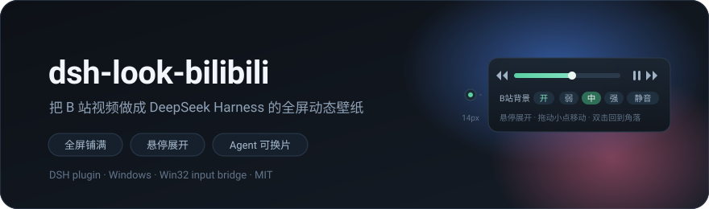
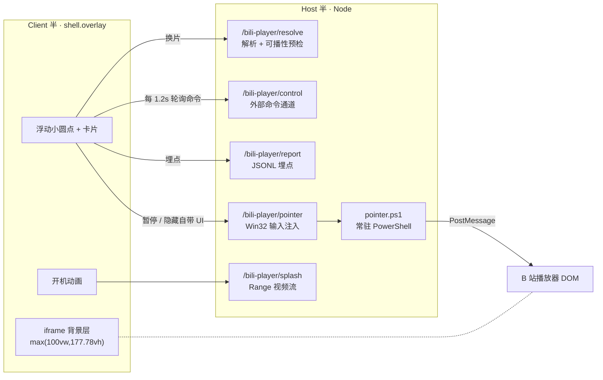

<div align="center">
  
</div>

<div align="center">

# dsh-look-bilibili

**把 B 站视频，做成 DeepSeek Harness 的全屏动态壁纸。**

铺满整帧，但不抢你正在读的字 · 控件收成一颗 14px 的小圆点 · 一句 curl 就能让 Agent 替你换片


[](#-环境要求)
[](LICENSE)
[](https://github.com/GantWu03/dsh-look-bilibili/stargazers)
[](https://github.com/GantWu03/dsh-look-bilibili/commits/main)

[快速开始](#-快速开始) · [界面与手势](#-界面与手势) · [给-Agent-用](#-让-agent-替你换背景) · [工作原理](#-工作原理) · [踩过的坑](#-三个真的会踩的坑) · [FAQ](#-faq)

</div>

---

## 这是什么

> 「写代码那个窗口太素了，我想让它后面放点东西。」

`dsh-look-bilibili` 是一个 **DSH 插件**：把 B 站官方外链播放器塞进聊天的背景层，铺满整个窗口，
再叠一层径向蒙版 —— 屏幕正中几乎透明，越往边缘越显影。于是它像壁纸，但永远不会让你看不清字。

它和 Lively Wallpaper 那类桌面壁纸的区别在于：

| | 桌面壁纸 | **dsh-look-bilibili** |
|---|---|---|
| 铺在哪 | 桌面 | **正在写作/对话的那个窗口里** |
| 挡不挡内容 | 不挡（桌面上没内容） | **挡，所以做了中心透明 + 三档浓度** |
| 换片方式 | 右键菜单 | 一颗会自己收起来的小圆点，**或者一条 HTTP 命令** |
| 谁来换 | 你 | **你，或者你的 Agent** |

第二列最后两行是这个项目真正的重点：**它把播放器也变成了 Agent 能调用的接口。**

## ✨ 特性

- 🎬 **整帧铺满，不留黑边** —— iframe 用 `width:max(100vw,177.78vh)` 居中裁切，任何窗口比例都是满的
- 🫥 **不抢正文** —— 透明度三档（弱/中/强）+ 径向蒙版，正文区永远优先
- 🪄 **一颗小圆点** —— 所有控件收起时只占 14px：悬停展开、按住拖动、双击回角落，位置记在 `localStorage`
- ⏮ **真的能换片** —— 粘链接 / BV / av / `b23.tv` 短链 / 番剧 `ep`·`ss` / 播放器链接，自动解析标题、分P、剧集，并**预检能不能播**
- ⏸ **能暂停、能 seek** —— 自建进度条 + Win32 `PostMessage` 注入点 B 站自己的按钮（跨域 iframe 的取舍，见[踩坑](#-三个真的会踩的坑)）
- 🤖 **Agent 可驱动** —— `POST /bili-player/control` 一条命令换背景，不用碰鼠标
- 🎞 **开机动画** —— 冷启动放一段 `assets/splash.mp4`，播完淡出，可随手换成自己的
- 🔌 **零依赖** —— 没有 npm 依赖，Host 半只有 4 个文件，Client 半单文件 1260 行

## 🚀 快速开始

### 环境要求

- **DSH 桌面端** ≥ 0.2.2（Web GUI 即可）
- **Windows 10 / 11** —— 暂停/隐藏播放器自带的按钮依赖 Win32 `PostMessage`（Linux/macOS 上背景、换片可用，暂停不可用）
- Node ≥ 20（DSH 自带）

### 安装

```bash
git clone https://github.com/GantWu03/dsh-look-bilibili.git
```

然后在 DSH 的**插件设置**里安装，安装地址填本地路径：

```
link:<你克隆下来的绝对路径>
```

例如：`link:D:\code\dsh-look-bilibili`

> 让 Agent 装也行，一句话：
> 「把这个仓库作为 bundle 装进 DSH：`link:D:\code\dsh-look-bilibili`」

装好后 **刷新一下 GUI**，左下角会出现一颗绿色小圆点。

### 第一件事

1. 鼠标移到那颗点上 —— 控件展开；
2. 点 **换片** → 粘一个 B 站链接 → **解析** → **用这个当背景**；
3. 觉得太亮？点 **弱**。想让它别出声？点 **静音**。不想看了？点 **关**。

## 🖱 界面与手势

```
平时     ●                                          悬停     ● ──┐ [⏮][━━━●━━━][⏸][⏭] 12:34/40:38 │
                                                                │ B站背景 P2 [关][弱][中][强][静音][换片] │
                                                                └──────────────────────────────────────┘
```

| 手势 / 按钮 | 效果 |
|---|---|
| **悬停**小圆点 | 展开两行控件；移开约 0.4s 自动收起 |
| **按住拖动**小圆点 | 整套控件跟着走，松手即记住（`localStorage: biliPlayer.transport.v1`） |
| **双击**小圆点 | 回到左下角 |
| **关 / 弱 / 中 / 强** | 关闭背景 / 三档浓度 |
| **静音 / 有声** | 切换 iframe 的 `muted` |
| 拖**进度条** | 重载到 `t=` 秒（有约 1s 黑屏，见踩坑 #1） |
| **⏸ / ▶** | 注入点击 B 站自己的播放按钮 |
| **⏮ / ⏭** | 上一集 / 下一集 |
| **换片** | 打开面板，见下 |

### 换片面板

| 输入 | 例子 |
|---|---|
| 视频页链接 | `https://www.bilibili.com/video/BV1xx411c7mD?p=2` |
| BV / av 号 | `BV1xx411c7mD`、`av170001` |
| 短链 | `https://b23.tv/xxxxxxx` |
| 番剧 | `https://www.bilibili.com/bangumi/play/ep123456`、`ss12345` |
| 播放器链接 | `https://player.bilibili.com/player.html?bvid=...&page=1` |

解析后会显示标题、UP 主、分P 列表（多 P 时）/ 剧集列表（番剧时），并给出**可播性预检**：
付费、版权、失效会直接告诉你原因，而不是给你一片黑屏。「起点」支持 `90` 或 `1:30`。

## 🤖 让 Agent 替你换背景

这是这个插件最有意思的部分：背景不是"你自己去点"，而是**一个可以被程序驱动的状态**。

```bash
B=http://127.0.0.1:61680          # 你的 GUI 端口

# 直接换片（内部会先解析、预检，再从第 600 秒开始放）
curl -X POST $B/bili-player/control \
  -H 'content-type: application/json' \
  -d '{"action":"apply","input":"https://www.bilibili.com/video/BV18paz6kE8m?p=6","t":600}'

# 只调开关：关掉背景 / 换浓度 / 静音 / 换分P
curl -X POST $B/bili-player/control -d '{"action":"set","enabled":false}'
curl -X POST $B/bili-player/control -d '{"action":"set","level":0}'
curl -X POST $B/bili-player/control -d '{"action":"set","muted":true}'
curl -X POST $B/bili-player/control -d '{"action":"set","page":3,"t":0}'

# 重播开机动画
curl -X POST $B/bili-player/control -d '{"action":"splash","sound":true}'
```

只想问"这是啥视频"？解析接口可以单独用：

```bash
curl "$B/bili-player/resolve?text=https://b23.tv/xxxxxxx"
# { "ok": true, "kind": "video", "bvid": "BV...", "title": "...", "owner": "...", "pages": [...], "warnings": [] }
```

于是你可以对 Agent 说：

> 「找一段下雨的城市夜景当背景，声音关掉，亮度调到弱。」

Agent 会自己解析候选、`set level=0`、`set muted=true`、`apply input=...`——**背景开始跟着对话走**。

## 🧠 工作原理



### 两条通道，因为一件事做不到

外链播放器是**跨域**的：`iframe.contentWindow` 读不到 `currentTime`，合成点击也不被它的按钮接受。
所以"控制播放"被拆成两条完全不同的通道：

| 操作 | 通道 | 为什么必须这样 |
|---|---|---|
| 进度条 seek | 改写 iframe 的 `t=` 参数（整页重载） | 拿不到 `currentTime`，只能靠 URL 参数重新加载 |
| ⏸ / ▶ 暂停 | Win32 `PostMessage` 注入真实鼠标消息 | 播放按钮是它自己文档里的普通元素，**DOM 合成点击无效，系统级消息有效** |
| ⏮ / ⏭ 换集 | 改写 `page=` / `episodeId=` | 换集本身就是换 URL |
| 隐藏它自带的标题条/进度条 | 加载后注入**一次** `WM_MOUSEMOVE` | 它的 UI 靠"鼠标活动"唤醒，静默 3s 后自己淡出；而背景层是 `pointer-events:none`，真实鼠标永远进不去 |

> DSH 的 Host 插件跑在 `ELECTRON_RUN_AS_NODE` 子进程里，拿不到 `webContents.sendInputEvent`。
> 于是 `pointer.ps1` 起了一个常驻 PowerShell，直接对窗口句柄 `PostMessage` —— **不动真实光标**，也不抢占你的鼠标。

## 🕳 三个真的会踩的坑

**1. 每次 seek 都黑一下？** 那是 `t=` 参数路线的固有代价：改 URL = 重载 iframe。已把重载压到最小（保留其它参数、只换 `t`），但仍会有约 1s 的空窗。

**2. 注入的点击没反应？** 命中测试。整层是 `pointer-events:none`，合成消息会被 Chromium 跳过，所以注入前后要把背景层和控件临时切成 `auto`/`none`，并**保持 180ms** 等目标线程处理完（`PostMessage` 只是入队）。另外**窗口必须是前台窗口**，否则 Chromium 直接丢弃合成鼠标消息。

**3. 悬停展开会"闪"？** 两个独立的坑，都写在 [`docs/TRANSPORT.md`](docs/TRANSPORT.md)：
- 卡片 `ref` 回调用内联函数时，React **每次渲染都解绑重绑**；而播放进度每秒重渲染一次 → 展开动画每秒重播 → 看起来像"关掉又出现"。修法：`ref` 用 `useCallback` 固定身份。
- 用 `pointerleave` 收起时，卡片长出来会改变布局，浏览器**补发假的 `leave`** → 收起 → 又进入 → 再展开。修法：改成监听 `pointermove` + 判断指针是否真的落在控件矩形内。

## ⚙️ 配置

插件配置只有一个可选字段：

| 字段 | 默认 | 说明 |
|---|---|---|
| `reportDir` | `%TEMP%/dsh-look-bilibili` | 埋点 JSONL（`player.jsonl`）的目录，排查问题时看这个 |

埋点什么？（`report` 路由，`GET /bili-player/report` 可直接读）—— 视口尺寸、iframe 铺满结果、`t=` 落地、注入耗时、悬停状态……
这个项目所有"看起来对不对"的判断都是靠读这份日志 + 亮度图做的，因为自动化环境里没有人眼。

## 📁 仓库结构

```
.
├── index.js            # Host：5 条路由（report / resolve / control / pointer / splash）
├── resolve.js          # 链接 → bvid/page 或 seasonId/episodeId，含可播性预检
├── pointer.js          # 与 pointer.ps1 常驻进程通信（NDJSON over stdio）
├── pointer.ps1         # Win32 注入：info/activate/move/click/drag/wheel/reset
├── client.js           # Client：背景层 + 浮控件 + 换片面板 + 开机动画
├── cordis.patch.yml    # bundle 的 patch：插入 bili-player 这一行
├── assets/splash.mp4   # 开机动画（换成你自己的即可）
├── docs/
│   ├── DETAIL.md       # 设计细节：路由、状态、蒙版、splash 的实测数据
│   ├── TRANSPORT.md     # 浮控件 + 两条通道 + 坐标换算 + 踩坑记录
│   └── hero.svg
├── locale/{zh,en}.json # 插件在市场里的标题与描述
└── icon.svg
```

## ⚠️ 已知限制

- **能不能播由嵌入播放器说了算**：番剧、大会员、付费、地区限制的内容可能黑屏或报错（解析阶段会预检并提示，但拦不住所有情况）；
- **未登录只有低清晰度**（实测 360P 档），`high_quality` 参数在 4.x embed 里已失效；
- **暂停依赖 Windows**：`PostMessage` 是 Win32 API，其它平台只有背景和换片可用；
- **背景层在内容之上**：视频不可能真的垫在文字下面，只能靠透明度 + 蒙版让步，所以永远不要把它调到"强"再去看代码；
- **开机动画只在冷启动播一次**（`sessionStorage` 标记），热重载不会重播。

## ❓ FAQ

<details>
<summary><b>装完左下角没东西？</b></summary>

刷新 GUI（`Ctrl+R`）。还不行就看插件是否 enabled，以及 Host 日志里有没有 `[bili-player]`。
</details>

<details>
<summary><b>点了 ⏸ 没反应？</b></summary>

窗口要在前台；第一次注入会付 `Add-Type` 编译时间（约 3.5s），插件启动时已经预热过，正常点击 110~220ms。
</details>

<details>
<summary><b>为什么进度条不准？</b></summary>

因为拿不到 `currentTime`。进度是"上次 seek + 每秒 +1s"的乐观估计，切集/缓冲会漂。点一下进度条就以你点的位置为准。
</details>

<details>
<summary><b>能换成 YouTube / 本地视频吗？</b></summary>

可以，改 `client.js` 里 `buildSrc()` 和 `resolve.js` 的解析分支即可 —— 背景层本身不关心源是哪来的，它只关心"一个能铺满的 iframe"。
</details>

<details>
<summary><b>会不会吃性能？</b></summary>

一个静音的 360P~1080P iframe 常驻。实测（2K 屏、DPR 2.0）额外开销主要来自合成层，不是 CPU。觉得热就点「关」。
</details>

## 🗺 Roadmap

- [x] 整帧铺满 + 三档浓度 + 径向蒙版
- [x] 浮动小圆点：悬停展开 / 拖动 / 双击复位
- [x] 换片面板：解析、分P、剧集、起点、可播性预检
- [x] 自建进度条 + Win32 暂停注入
- [x] 开机动画（可替换）
- [x] Agent 控制通道（`/control`、`/resolve`）
- [ ] 记住每个会话各自的背景
- [ ] 播放列表 / 定时轮换
- [ ] 非 Windows 平台的暂停降级方案

## 📄 License

[MIT](LICENSE) © GantWu03

B 站视频版权归原作者与 B 站所有 —— 这个插件只负责**显示你选择的内容**，不托管、不下载、不分发任何视频。
`assets/splash.mp4` 是一个可替换的开屏动画占位资源。

<div align="center">
<sub>如果它让你的窗口好看了一点点，给个 ⭐ 吧。</sub>
</div>

---

## English

**A Bilibili live wallpaper for DeepSeek Harness.**

This is a DSH plugin that mounts the official Bilibili embed player as a full-frame background
behind the chat, with a radial mask so the centre stays readable. All controls collapse into a
single 14px dot: hover to expand, drag to move, double-click to reset.

The interesting half is not the video — it is that the player is **cross-origin**, so this repo
solves it twice over: seeking rewrites the `t=` URL parameter (the only handle it has), while
pausing goes through a Win32 `PostMessage` bridge into the embed's own buttons. Background,
video swapping and playback state are also exposed as a tiny HTTP control channel, which means
**an agent can change your wallpaper** with one `curl`.

| | |
|---|---|
| Platform | Windows 10/11 (pause requires Win32) |
| Install | `git clone` → install `link:<absolute path>` in DSH plugin settings |
| License | MIT |

See [docs/DETAIL.md](docs/DETAIL.md) and [docs/TRANSPORT.md](docs/TRANSPORT.md) for the full design notes (Chinese).
